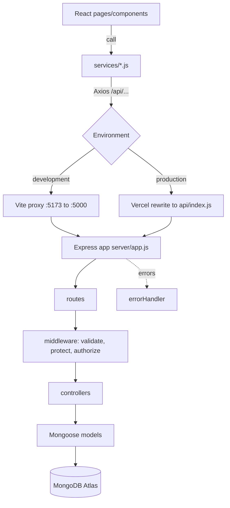
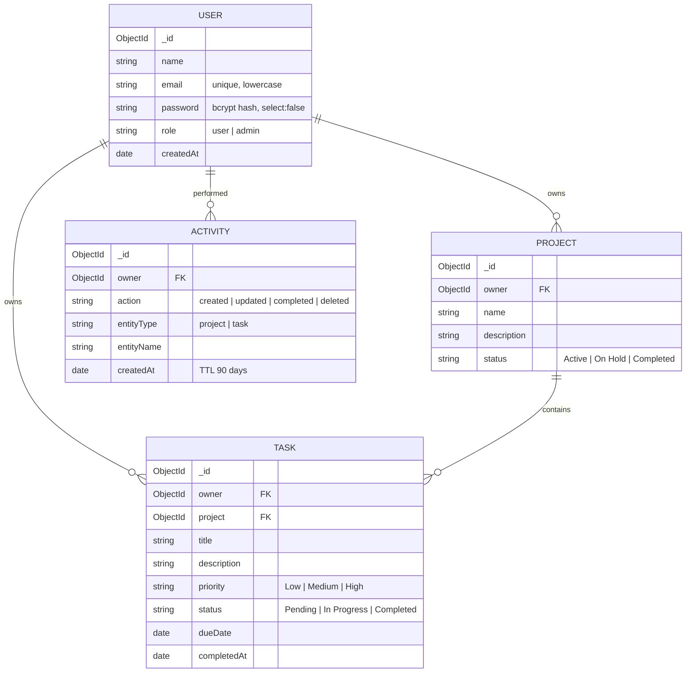

# TaskFlow Architecture

## 1. The big picture

```
┌──────────────────────┐
│   React Frontend     │  Vite + React Router + Context API + Tailwind
│  (runs in browser)   │  pages → services → Axios
└──────────┬───────────┘
           │  HTTP + JSON, cookie "token" travels automatically (withCredentials)
           ▼
┌──────────────────────┐
│  Axios HTTP request  │  baseURL "/api"  (same origin → no CORS)
└──────────┬───────────┘
           │  dev: Vite proxy :5173 → :5000      prod: Vercel rewrite /api/* → api/index.js
           ▼
┌──────────────────────┐
│ Node.js + Express    │  helmet, JSON parser, cookie parser, (CORS if CLIENT_URL set)
│ REST API             │
└──────────┬───────────┘
           ▼
┌──────────────────────┐
│ Router               │  /api/auth /api/projects /api/tasks /api/dashboard /api/users /api/admin
└──────────┬───────────┘
           ▼
┌──────────────────────┐
│ Middleware chain     │  rate limiter → validate (Zod) → protect (JWT) → authorize (role)
└──────────┬───────────┘
           ▼
┌──────────────────────┐
│ Controllers          │  business rules + ownership checks
└──────────┬───────────┘
           ▼
┌──────────────────────┐
│ Mongoose models      │  User · Project · Task · Activity (schemas, hooks, indexes)
└──────────┬───────────┘
           ▼
┌──────────────────────┐
│ MongoDB Atlas        │
└──────────────────────┘
        errors anywhere → errorHandler → { success:false, message, errors? }
```



## 2. Same code, three hosts

`server/app.js` builds and **exports** the Express app without calling `listen()`:

| Host | Entry | How the app is used |
|---|---|---|
| Local dev | `server/dev.js` | `app.listen(5000)` |
| Vercel | `api/index.js` | `export default app` – Vercel calls it as `(req, res)` per request |
| Tests | `tests/helpers.js` | Supertest wraps the app in an ephemeral server |

## 3. Request lifecycle (example: create a task)

`POST /api/tasks` with body `{"title":"Write report","project":"<id>","priority":"High"}`

1. **React** `TaskForm` → `taskService.createTask(payload)` → `api.post("/tasks", payload)`.
2. **Axios** adds `Content-Type: application/json`; the browser attaches the `token` cookie.
3. **Proxy / rewrite** forwards to Express (path stays `/api/tasks`).
4. **helmet / json / cookieParser** run. `connectDB()` ensures a (cached) Mongo connection.
5. **`taskRoutes`**: `protect` → `validate(taskCreateSchema)` → `createTask`.
6. **`protect`**: reads cookie → `jwt.verify` → `User.findById` → sets `req.user`. Missing/invalid → `401`.
7. **`validate`**: Zod trims strings, applies defaults (`status: "Pending"`), checks enums/ObjectId/date. Invalid → `400` with `errors:[{field,message}]`.
8. **Controller**: confirms the project belongs to `req.user` (else `400`), creates the task with `owner: req.user._id` (**never** from the body), logs an Activity row.
9. **Response** `201 {"success":true,"data":{"task":{…}}}`.
10. **React** closes the modal, shows a toast and reloads the list.

## 4. Database design



* **References, not embedding:** tasks reference their project and owner by `ObjectId`; Mongoose `populate()` joins the project name when listing tasks.
* **Denormalised `owner` on Task:** lets every task query filter by `owner` directly (fast + safe) without first loading the project.
* **Indexes:** `User.email` (unique), `owner` on Project/Task/Activity, `{owner,status}` on Task, `{owner,createdAt}` on Activity, TTL on `Activity.createdAt`.
* **Cascade:** deleting a project deletes its tasks (`projectController.deleteProject`).

## 5. Authentication & authorization workflow

```mermaid
sequenceDiagram
  participant B as Browser (React)
  participant S as Express API
  participant D as MongoDB
  Note over B,D: Registration
  B->>S: POST /api/auth/register {name,email,password}
  S->>S: Zod validation
  S->>D: User.exists({email})
  S->>S: User.create → pre-save hook: bcrypt.hash(password)
  S->>D: insert {name,email,password:"$2a$10$…"}
  S->>S: jwt.sign({id}) 
  S-->>B: 201 {user} + Set-Cookie: token=JWT; HttpOnly; Secure; SameSite=Lax
  Note over B,D: Login
  B->>S: POST /api/auth/login {email,password}
  S->>D: findOne({email}).select("+password")
  S->>S: bcrypt.compare(password, hash)
  S-->>B: 200 {user} + Set-Cookie
  Note over B,D: Protected request
  B->>S: GET /api/projects (cookie sent automatically)
  S->>S: protect: jwt.verify(cookie) 
  S->>D: User.findById(id) → req.user
  S->>D: Project.find({owner: req.user._id})
  S-->>B: 200 {projects}
  Note over B,D: Logout
  B->>S: POST /api/auth/logout
  S-->>B: 200 + Set-Cookie: token=; Expires=1970
```

```
Login flowchart
 ┌─────────────┐   invalid format?   ┌──────────────┐
 │ POST /login │ ─────── yes ──────▶ │ 400 + errors │
 └──────┬──────┘                     └──────────────┘
        │ valid
        ▼
 user found by email? ── no ─▶ (dummy bcrypt compare) ─▶ 401 "Invalid email or password"
        │ yes
        ▼
 bcrypt.compare ok? ─── no ─────────────────────────────▶ 401 "Invalid email or password"
        │ yes
        ▼
 sign JWT {id} (7d) → Set-Cookie (HttpOnly, SameSite=Lax, Secure in prod) → 200 {user}
```

**Session restore on refresh:** React cannot read an HTTP-only cookie, so `AuthProvider` calls `GET /api/auth/me` on startup. `200` → user is logged in; `401` → anonymous.

**Authorization layers**
1. *Route level* – `protect` (logged in?), `authorize("admin")` (role).
2. *Data level* – every query includes `owner: req.user._id`. Another user's id returns **404** (not 403), so IDs of other people's data cannot even be probed.
3. *UI level* – `ProtectedRoute` is only a convenience for navigation; **the backend is the real security boundary**.

## 6. API architecture

* Resource-oriented REST: nouns in URLs, HTTP verbs for actions (`GET` read, `POST` create, `PUT` update, `DELETE` remove).
* Uniform envelope: success `{ success:true, data:{…} }`, failure `{ success:false, message, errors? }`.
* Status codes: `200/201` success, `400` validation, `401` not logged in, `403` wrong role, `404` not found / not yours, `409` duplicate, `429` rate limited, `503` database unavailable.
* Query features on lists: `q`, `status`, `priority`, `project`, `sort`, `page`, `limit`.
* Full endpoint list: [API_DOCUMENTATION.md](API_DOCUMENTATION.md).

## 7. Frontend architecture

```
main.jsx → BrowserRouter → ToastProvider → AuthProvider → App (routes)
App routes
 ├─ PublicOnlyRoute  → /login, /register
 └─ ProtectedRoute   → AppLayout (sidebar + topbar) → /dashboard /projects /tasks /profile
pages → services/*.js → services/api.js (single Axios instance)
```
* **State:** local `useState` per page; global auth in Context; toasts in Context.
* **Services layer:** pages never call Axios directly – one place to change URLs/error handling.
* **Axios interceptor:** a `401` from any non-auth endpoint clears the user, so `ProtectedRoute` redirects to `/login`.

## 8. Deployment architecture (Vercel)

```
GitHub push ─▶ Vercel build: npm install (root) → npm --prefix client install && build
                │
                ├─ static files: client/dist  (served from Vercel's CDN)
                └─ serverless function: api/index.js (Express app) ── MongoDB Atlas
Routing (vercel.json):
   /api/*        → /api            (function)
   everything else (not a file) → /index.html   (React Router handles the URL)
```
Serverless notes: connections are cached on `global` between warm invocations (`server/config/db.js`); the in-memory rate limiter is per instance (best-effort).
